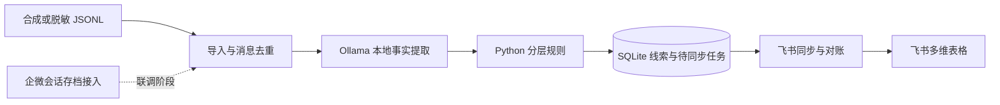

# 企微私聊分层与飞书同步技术方案

技术选型已确认，采用方案 A。业务范围、分层口径和业务指标见 [首版方案](./plan-wecom-segmentation.md)。本方案面向中国大陆、单个企微成员和单人操作，优先使用现有 Mac，控制持续成本。

## 1. 技术框架

| 层 | 选型 | 负责的工作 |
| --- | --- | --- |
| 应用入口 | Python 3.13、`venv`、`argparse` | 提供本地命令行，管理依赖与运行参数。 |
| 本地状态 | Python 标准库 `sqlite3` | 保存消息处理进度、线索状态、飞书行映射和待同步任务。 |
| 事实提取 | Ollama 本地模式、`qwen3:4b`、Pydantic | 按 JSON Schema 提取事实，再用同一份结构定义验证输出。 |
| 分层 | Python 规则函数 | 从已验证事实计算线索阶段、跟进状态和待核实标记。 |
| 运营表格 | 飞书多维表格、官方 `lark-oapi` Python SDK | 查询、新增和更新线索行，复用 SDK 的身份凭证管理。 |
| 运行方式 | Mac 手动触发，定时阶段使用 `launchd` | 样本阶段由命令触发，联调后复用同一入口定时执行。 |
| 测试 | Python 标准库 `unittest` 和 `unittest.mock` | 复用同一套标注样本，覆盖规则、存储、同步及错误恢复。 |

[Python `sqlite3`](https://docs.python.org/3.13/library/sqlite3.html) · [Ollama 结构化输出](https://docs.ollama.com/capabilities/structured-outputs) · [Pydantic JSON Schema](https://docs.pydantic.dev/latest/concepts/json_schema/) · [飞书官方 Python SDK](https://github.com/larksuite/oapi-sdk-python) · [Apple 定时任务](https://developer.apple.com/library/archive/documentation/MacOSX/Conceptual/BPSystemStartup/Chapters/ScheduledJobs.html)

### 方案 A｜Mac 本地运行与分析（已选）

- Python 和 SQLite 运行在现有 Mac 上。Ollama 使用本地模型，应用只连接本机推理服务，飞书用于查看和复核线索。适合少量会话、单人使用和低维护成本的试点。
- 模型下载完成后，推理可在 Mac 本地完成。同步需要访问飞书开放平台。需要管理本机模型文件、SQLite 备份、飞书凭证和目标表格权限。主要待验证项是模型内存占用、耗时和准确率。[Ollama macOS 要求](https://docs.ollama.com/macos) · [Ollama 本地模式](https://docs.ollama.com/faq#how-do-i-disable-ollamas-cloud-features)

### 方案 B｜Mac 运行程序，国内云端提取（备选）

- Python、SQLite 和飞书部分相同，提取可改为阿里云百炼北京区域的 `qwen-flash`。维护侧少管理一个本地模型，多管理一套 API 密钥、网络依赖和用量。
- 北京区域短输入档官方原价为每百万 token 输入 ¥0.15、输出 ¥1.50。待分析文本会发往模型服务，需要先确认真实会话的处理权限。方案 A 已确认，首版实现范围采用本地提取。[百炼 `qwen-flash` 官方规格与计费](https://help.aliyun.com/en/model-studio/qwen-flash)

方案 A 的决定性理由是单账号试点可以在现有 Mac 上分析私聊，避免另购服务器和模型按次费用。后续若本地实测质量或速度达不到试点需求，再按样本结果调整模型。替换成云服务取决于真实会话的第三方处理权限。会话存档开通和 SDK 兼容性只影响采集模块的联调。

## 2. 数据流和模块



| 模块 | 输入与输出 |
| --- | --- |
| 导入 | 先支持 JSONL，即每行一个 JSON 消息。验证 `message_id`、`contact_id`、时间、说话人和正文，标记样本或试点数据。消息按时间和消息 ID 稳定排序，已导入的同一消息重复出现时复用状态。 |
| 提取 | 按联系人读取上下文，向本地 Ollama 请求结构化事实。每项事实绑定证据消息 ID。程序验证枚举值、证据归属和消息可见性。无效响应留待重试，保留上一份有效结果。 |
| 分层 | 处理资料领取、学段、需求、预约确认和取消等事实，生成线索快照。当前阶段、有效线索判定、跟进状态、到课和付费核实状态分别计算。 |
| 存储 | 同一事务保存线索版本和待同步任务。模型、规则和提示词版本随快照记录，供样本对比和回放。 |
| 同步 | 通过字段白名单生成飞书写入内容。按线索 ID 查找记录，保存 `record_id`，串行执行写入和对账。 |

提取内容用于数据判定。证据摘要从有证据关联的客户消息中选取关键短句，每句用中文引号包裹。含常见联系方式或个人标识的片段会跳过。报名意向和预约确认需要对应证据，客户自述已到课或已付款仅生成待核实标记。

建议命令如下，命令名称在实现时保持稳定。

```shell
python -m wecom_segmentation import --file samples/conversations.jsonl
python -m wecom_segmentation classify
python -m wecom_segmentation sync --dry-run
python -m wecom_segmentation sync
python -m wecom_segmentation status
```

`sync --dry-run` 在本机预览将写入的脱敏字段，无需飞书凭证。`status` 显示已处理联系人、待同步、待对账和失败数量。

## 3. 本地数据与飞书字段

| 本地实体 | 主键及用途 |
| --- | --- |
| 消息索引 | 以来源命名空间和消息 ID 去重，保存联系人、顺序、来源位置及撤回标记。样本文件和试点数据使用独立命名空间。 |
| 线索快照 | 以稳定的线索 ID 唯一标识。保存当前业务字段、首次达成时间、脱敏证据引用和单调递增的版本。 |
| 同步记录 | 以目标表格和线索 ID 标识，保存飞书 `record_id`、最近已确认同步版本及首次创建的 `client_token`。 |
| 待同步任务 | 以目标表格、线索 ID 和版本标识，保存任务状态、固定请求内容、重试次数、下次重试时间和错误类别。 |
| 采集进度 | 存档阶段按成员及来源保存增量拉取位置。只有数据或可重放引用持久化成功后才推进进度。 |

线索 ID 用本地持久化映射生成，避免把企微原始联系人 ID 直接写到飞书。时间在应用内部统一为带时区的时间，飞书日期字段转换为毫秒时间戳。飞书「线索」表按 [业务字段](./plan-wecom-segmentation.md#飞书多维表格) 建列，增加一个用于对账的「同步版本」字段。人工复核备注由使用者在飞书编辑，程序写入时省略该字段。撤回或改期需要清空的自动字段按飞书对应类型的清空规则提交，并列入联调验收。

原文和附件留在原数据来源。样本原文从本机文件读取，SQLite 保存消息索引和结构化结果。接入存档后验证历史消息的重放范围，并确定可用的本地重放方式。撤回、迟到或纠正消息到来时，从可重放来源重新计算受影响线索。证据被撤回时立即作废依赖该证据的事实。缺少必要历史时标记待复核，保留仍有依据的事实。

## 4. 同步、失败恢复与数据边界

1. **首次写入**。用具有查询和写入权限的同一应用身份，在目标表按线索 ID 查询。找到一行就绑定其 `record_id`，多行进入待对账。确认应创建时，先在 SQLite 保存 UUIDv4 `client_token` 和该次请求内容，再提交创建。同一次创建重试复用同一令牌与请求内容。[飞书新增记录与幂等参数](https://open.feishu.cn/document/server-docs/docs/bitable-v1/app-table-record/create)
2. **后续更新**。按 `record_id` 写入系统维护字段和同步版本。任务发送前检查当前本地版本，跳过尚未发送且已被更新版本替代的任务。收到成功响应后再登记已同步版本。运行时只允许一个任务进程占用同一数据库，目标表串行写入。
3. **超时或进程退出**。恢复时先按线索 ID 或 `record_id` 查行及同步版本。已落表的操作补记成功。无法确认的创建用原令牌对账或重试，令牌冲突进入待对账。结果不明的更新先解决当前版本，再发送该联系人更新版本，避免旧请求覆盖新状态。
4. **可恢复与配置错误**。同时检查 HTTP 状态和飞书业务错误码。网络错误、限流和暂时冲突采用有上限的退避重试。权限、表结构和字段类型错误保留任务与诊断，配置修复后重放。应用身份需要相应 API 权限和目标表格编辑权限。用测试表中已有的记录验证查询权限，再验证写入。[飞书权限与常见错误](https://open.feishu.cn/document/docs/bitable-v1/faq)
5. **凭证与日志**。飞书凭证保存在 Mac 本地受限配置中，从运行环境读取。样本、真实会话数据、数据库和密钥使用各自的运行路径，真实数据与密钥留在 Git 工作区之外。日志记录任务 ID、错误类别和耗时，飞书写入内容限结构化字段与脱敏摘要。模型配置固定连接本机地址。

## 5. 实施与验收

| 阶段 | 交付与通过条件 |
| --- | --- |
| 一、离线分层 | 用合成 JSONL 走通导入、提取、规则和本地预览。覆盖 [首批业务用例](./plan-wecom-segmentation.md#首批验收用例)，加测无效模型输出、撤回和迟到消息。用 40–60 段独立标注会话评估，报告有效线索精确率、召回率、处理耗时和峰值内存。初步目标为有效线索精确率和召回率各 90%。 |
| 二、飞书测试表 | 用样本验证新增、更新、字段清空、人工备注保留和结果不明时的重试。模拟「创建成功但响应丢失」和「写入成功后进程退出」，重放后同一线索仍只有一行。 |
| 三、企微单账号联调 | 确认所属企业的会话存档开通情况、试点成员范围、可用私聊、SDK 运行环境和网络要求。再验证增量拉取、断点恢复和定时运行。Mac 原生 SDK 可用性待实测确认，采集模块通过相同消息格式接入。[企微会话存档接口](https://developer.work.weixin.qq.com/document/path/91774) |

首个开发里程碑是让一份样本从导入走到本地预览。阶段二需要飞书测试表和应用权限。阶段三依赖实际企微会话存档条件。当前方案确认了技术栈，尚未进行模型跑分、飞书写入或企微 SDK 联调。
